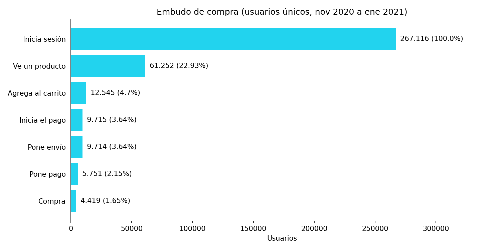
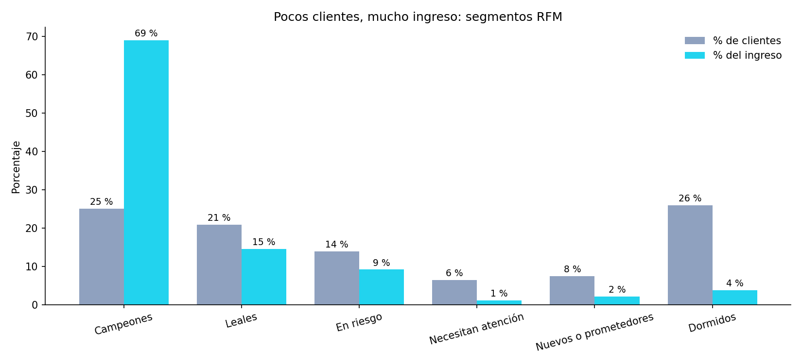
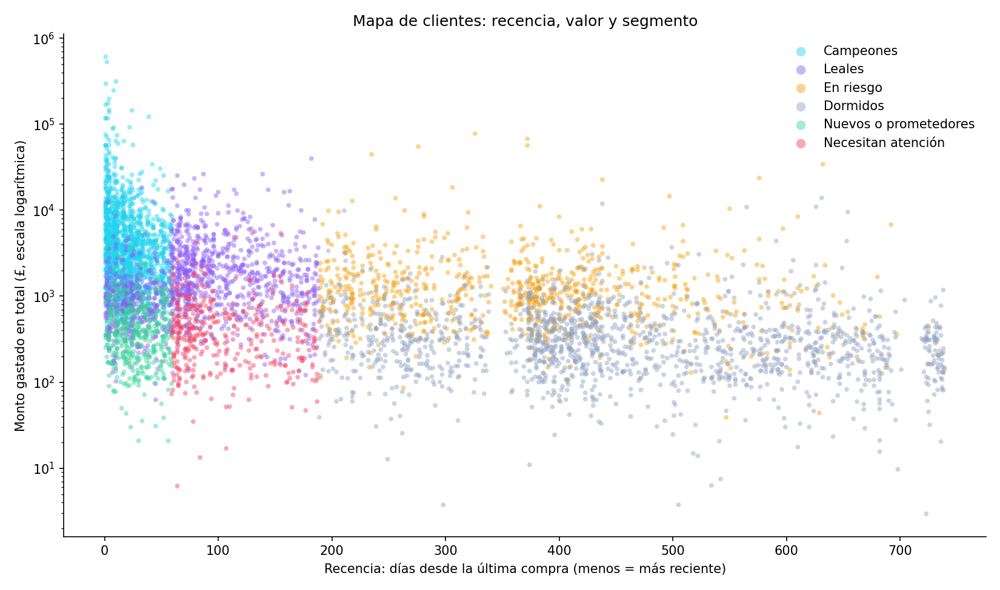
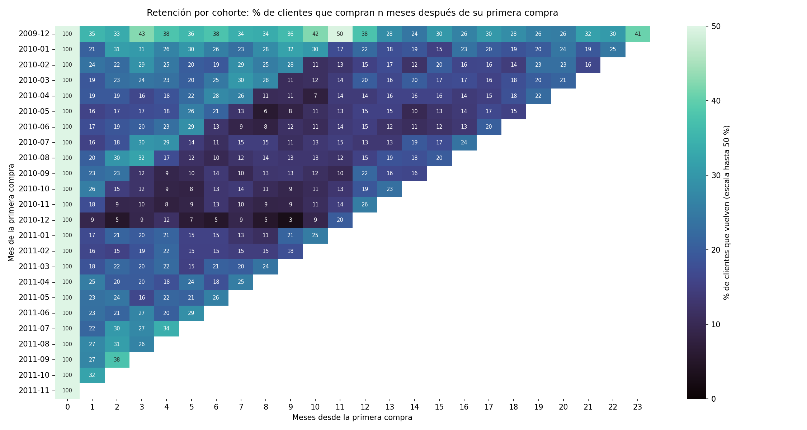
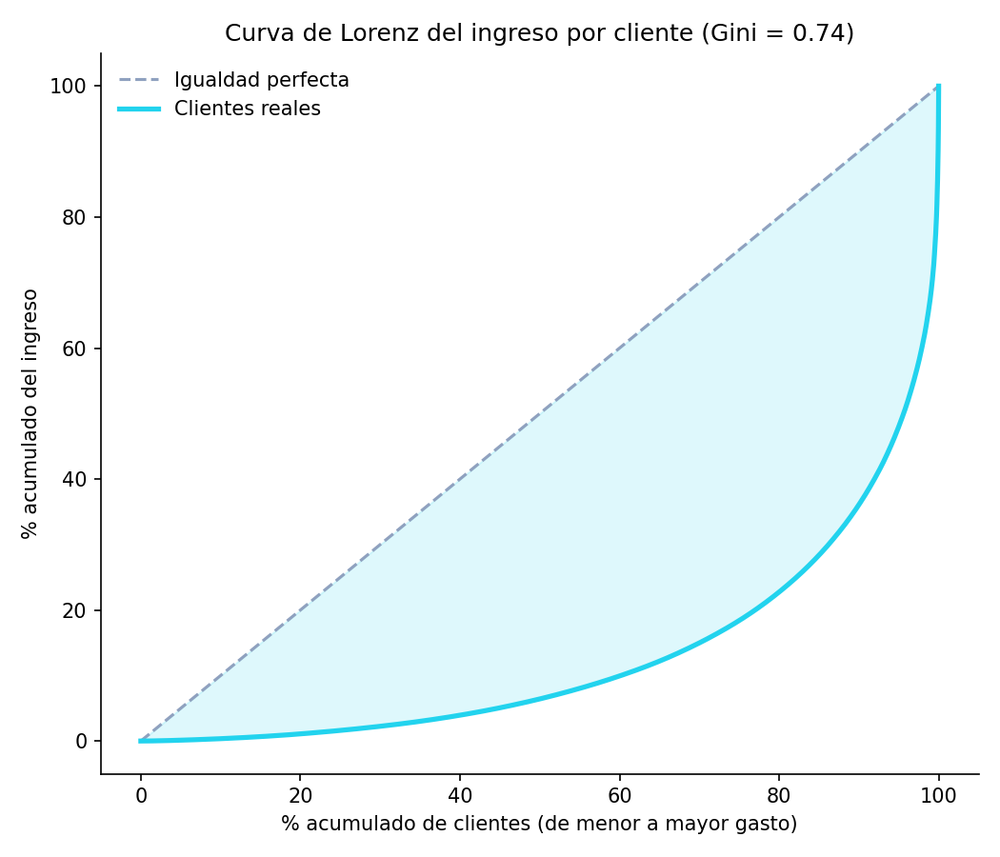
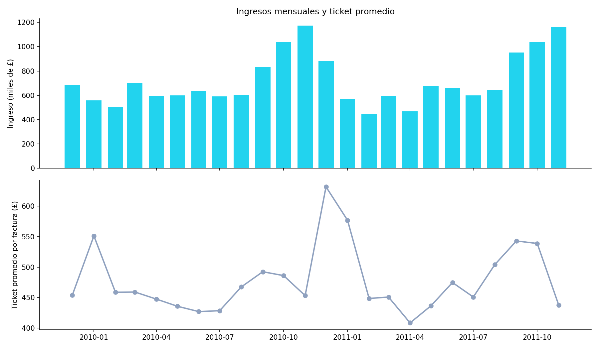
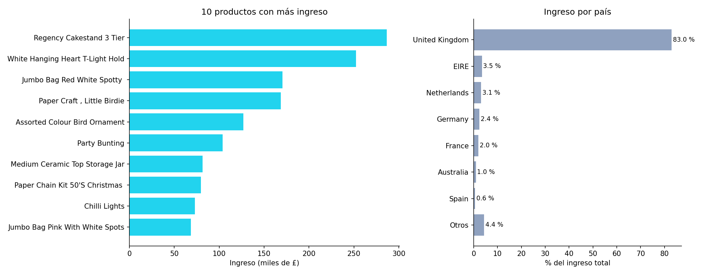
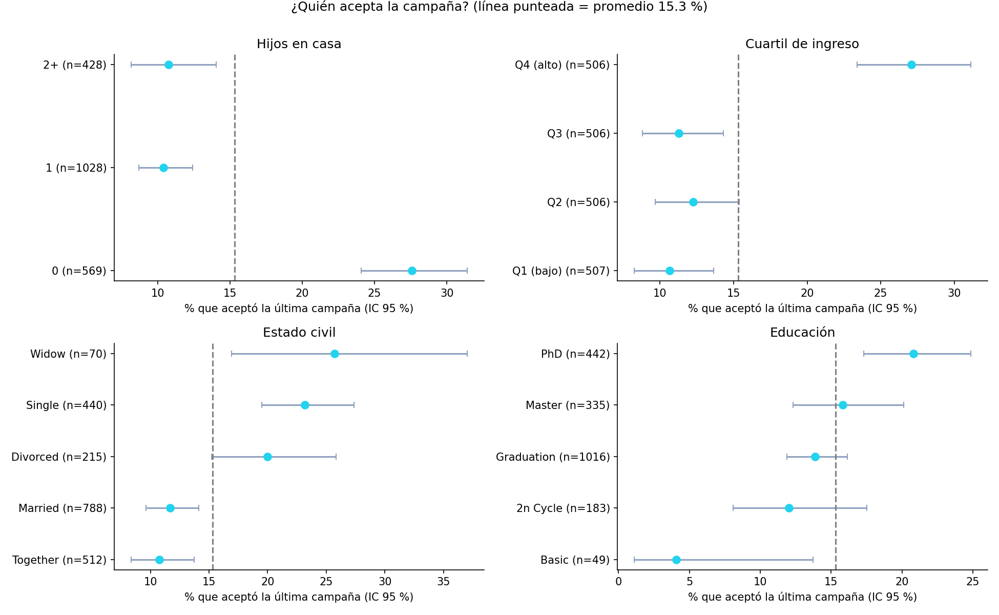
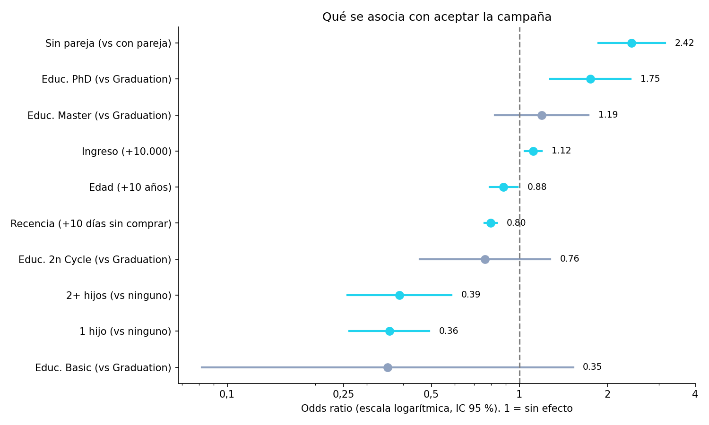
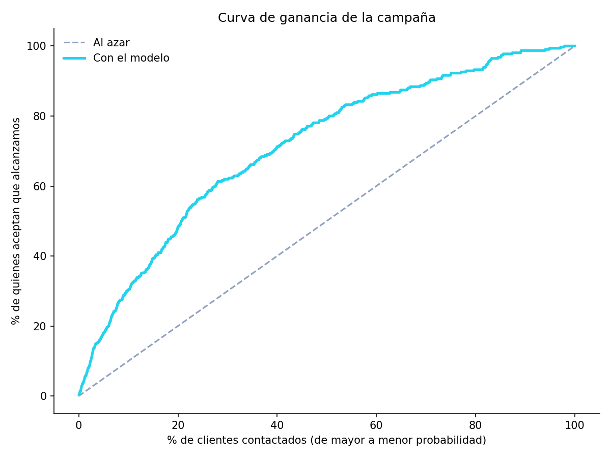

# Marketing Analytics: ¿de dónde vienen los clientes y dónde se pierden?

Proyecto de analítica de marketing en varias fases, con datos reales y estadística, publicado fase por fase.

- **Fase 1:** adquisición y embudo de compra con **Google Analytics 4** (SQL en BigQuery y Python).
- **Fase 2:** segmentación de clientes **RFM**, **cohortes de retención** y concentración del ingreso (Python).
- **Fase 3:** campañas de marketing: **perfil de quien acepta**, pruebas estadísticas, regresión logística y modelo de priorización (Python).

> Estado: **Fases 1, 2 y 3 de 6 terminadas.** Las demás se irán publicando en este mismo repositorio (ver hoja de ruta al final).

---

# Fase 1: adquisición y embudo (GA4)

## Pregunta de negocio

¿Cuántos visitantes terminan comprando, en qué paso del embudo se pierden más, qué canales de adquisición convierten mejor (y si esa diferencia es real o es ruido) y cuándo visitan la tienda?

## Datos

Muestra pública de GA4 de **Google Merchandise Store** (`bigquery-public-data.ga4_obfuscated_sample_ecommerce`), del **1 de noviembre de 2020 al 31 de enero de 2021**, con identificadores ofuscados. Los datos **no se incluyen en este repositorio**: se consultan directamente en BigQuery (el modo gratuito, *sandbox*, alcanza).

## Cómo se hizo

1. **SQL en BigQuery:** consultas sobre las tablas de eventos (`events_*`).
2. **Atribución por usuario:** cada usuario se asigna al canal de su **primer evento** (`ARRAY_AGG(... ORDER BY event_timestamp LIMIT 1)`). Una primera versión contaba a los usuarios en varios canales (≈333 mil en lugar de 270.154); se corrigió y los totales cuadran.
3. **Embudo:** usuarios únicos que llegan a cada paso.
4. **Estadística:** prueba de independencia chi-cuadrado entre canal y compra, pruebas de un canal contra el resto con **corrección de Holm** para comparaciones múltiples, e **intervalos de confianza de Wilson al 95 %**.
5. **Series de tiempo y patrones:** visitas e ingresos diarios con promedio móvil de 7 días y mapa de calor por día y hora.

## Resultados

### 1. Embudo de compra



De **267.116** usuarios que inician sesión, **4.419 compran (1,65 %)**.

| Paso | Usuarios | % del inicio | % del paso anterior |
|---|---:|---:|---:|
| Inicia sesión | 267.116 | 100 % | |
| Ve un producto | 61.252 | 22,9 % | 22,9 % |
| Agrega al carrito | 12.545 | 4,7 % | 20,5 % |
| Inicia el pago | 9.715 | 3,6 % | 77,4 % |
| Pone envío | 9.714 | 3,6 % | ~100 % |
| Pone pago | 5.751 | 2,2 % | 59,2 % |
| Compra | 4.419 | 1,7 % | 76,8 % |

- **La mayor pérdida está al principio:** solo 2 de cada 10 usuarios ven un producto, y solo 2 de cada 10 de quienes lo ven lo agregan al carrito.
- **Dentro del pago, el paso más débil es "poner pago":** pierde cerca de 4 de cada 10 usuarios que ya habían puesto el envío.
- "Inicia el pago" y "pone envío" tienen casi el mismo número (9.715 y 9.714). Probablemente ambos eventos se disparan juntos en esta tienda, así que no se interpretan como dos pasos distintos.

### 2. Conversión por canal de adquisición


- La conversión general es de **≈1,6 %** de los usuarios.
- El canal `shop.googlemerchandisestore.com / referral` destaca con **≈2,2 %** (IC 95 % aproximado de 2,0 % a 2,5 %), por encima del promedio.
- La prueba chi-cuadrado indica que **la conversión no es igual en todos los canales** (χ² = 49,1; 6 grados de libertad; p < 0,001).
- Para los demás canales, los intervalos de confianza se cruzan con el promedio: con estos datos **no se puede afirmar** que unos sean mejores que otros. Por ejemplo, `google / cpc` (≈1,5 %) tiene un intervalo muy ancho.

### 3. Visitas e ingresos diarios


- Las visitas diarias oscilan entre ≈2.000 y ≈6.700 usuarios, con un pico a inicios de diciembre.
- Los ingresos suben desde mediados de noviembre y alcanzan su nivel más alto en **diciembre** (promedio móvil de 7 días cerca de 8.800 USD, con días de hasta ≈12.000 USD), y caen con fuerza después de Navidad.
- **Black Friday no destaca** en los ingresos de esta muestra frente a otros días de la temporada.

### 4. ¿Cuándo visitan la tienda?


- **Martes y miércoles** concentran más sesiones y el **sábado** es el día más flojo.
- Dentro de cada día, la hora cambia poco. Casi toda la diferencia está entre días de la semana.

## Limitaciones de la Fase 1

- **No hay datos de gasto en publicidad:** se puede medir conversión por canal, pero no ROAS ni costo por adquisición.
- **Solo 13 semanas, con festivos dentro:** los patrones por día de la semana pueden mezclarse con feriados y temporada.
- **Canales poco informativos:** varios aparecen como `<Other>` por la ofuscación de la muestra, y la categoría `(data deleted)` se excluyó por no ser un canal real.
- **Embudo por usuarios únicos:** cuenta cuántos usuarios llegaron a cada paso, no valida el orden estricto dentro de una misma sesión.
- **Mapa de calor:** asume la hora del Pacífico de EE. UU. (America/Los_Angeles), y la muestra es de una sola tienda.
- Las diferencias entre canales son **asociaciones**, no causalidad.
- Los últimos días de enero muestran ingresos casi nulos; puede ser un artefacto del corte de la muestra y no un comportamiento real.

---

# Fase 2: segmentación RFM y cohortes de retención

## Pregunta de negocio

¿Qué clientes aportan el valor, cuántos se pierden y cuándo, y qué tan concentrado está el ingreso?

## Datos

[Online Retail II](https://archive.ics.uci.edu/dataset/502/online+retail+ii) (UCI / Kaggle): transacciones de una tienda en línea del Reino Unido, del **1 de diciembre de 2009 al 9 de diciembre de 2011**. Los datos **no se incluyen en este repositorio**. Los importes están en **libras esterlinas (£)**.

## Cómo se hizo

1. **Limpieza** (cada paso con su conteo):

| Paso | Filas |
|---|---:|
| Filas originales | 1.067.371 |
| Sin identificador de cliente (se quitan) | 243.007 |
| Devoluciones y cancelaciones (se quitan) | 18.744 |
| Cantidad o precio ≤ 0 (se quitan) | 71 |
| **Filas finales** | **805.549** |

   Quedan **5.878 clientes**, **36.969 facturas** y **£17.743.429** de ingreso.

2. **RFM:** por cliente se calcula **Recencia** (días desde su última compra, con fecha de referencia 10/12/2011), **Frecuencia** (facturas distintas) y **Monto** (ingreso total).
3. **Puntaje con quintiles (1 a 5):** como los montos están muy sesgados (promedio £3.019 contra mediana £899), se usan quintiles por rango para que unos pocos clientes enormes no distorsionen la escala.
4. **Segmentos** con reglas sobre los puntajes de R y F.
5. **Cohortes:** cada cliente se asigna al mes de su primera compra y se mide qué porcentaje compra en los meses siguientes.
6. **Concentración del ingreso:** curva de Lorenz e índice de Gini.
7. **Estadística:** prueba chi-cuadrado y odds ratio con intervalo de confianza de 95 %.

## Resultados

### 1. Segmentos de clientes



| Segmento | Clientes | % clientes | % ingreso | Recencia (mediana, días) | Facturas (mediana) | Monto (mediana, £) |
|---|---:|---:|---:|---:|---:|---:|
| Campeones | 1.473 | 25 % | **69 %** | 17 | 10 | 3.465 |
| Leales | 1.229 | 21 % | 15 % | 72 | 4 | 1.232 |
| En riesgo | 825 | 14 % | 9 % | 374 | 4 | 1.040 |
| Dormidos | 1.526 | 26 % | 4 % | 434 | 1 | 285 |
| Nuevos o prometedores | 441 | 8 % | 2 % | 26 | 1 | 373 |
| Necesitan atención | 384 | 6 % | 1 % | 93 | 1 | 370 |

- **El 25 % de los clientes (Campeones) genera el 69 % del ingreso.**
- **En riesgo** (825 clientes) compraban de forma recurrente (mediana de 4 facturas, £1,6 millones acumulados) y llevan más de un año sin volver: es el grupo con más sentido para una campaña de reactivación.
- **Dormidos** son el 26 % de los clientes pero solo el 4 % del ingreso; la mayoría compró una vez.



### 2. Retención por cohorte



- Cada fila es el grupo de clientes que compró por primera vez en ese mes; cada celda es el % de ese grupo que compra *n* meses después.
- En promedio (sin la cohorte de dic-2009), vuelve **≈ 21 %** al mes 1, **≈ 21 %** al mes 3, **≈ 17 %** al mes 6 y **≈ 18 %** al mes 12. La retención **se estabiliza** en ese nivel: hay un núcleo de clientes que vuelve de forma regular.
- La cohorte de dic-2009 muestra un pico de 50 % al mes 11 (noviembre de 2010), compatible con recompra de temporada. La cohorte de dic-2010 fue la más débil (≈ 9 % al mes 1).

**¿La temporada alta atrae clientes que vuelven menos?** Se comparó la retención al mes 1 de los clientes que entraron en oct-dic contra los del resto del año (cohortes de ene-2010 a oct-2011):

| | No volvió | Volvió | % que volvió |
|---|---:|---:|---:|
| Resto del año | 2.947 | 758 | 20,5 % |
| Oct-Dic | 767 | 232 | 23,2 % |

χ² = 3,45 (1 g. l.), p = 0,063; **odds ratio = 1,18** (IC 95 %: 0,99 a 1,39). **No hay evidencia suficiente** de que sean distintos, y la dirección va en contra de la sospecha inicial: lo oscuro de dic-2010 parece una cohorte puntual y no un patrón. Esta comparación se eligió después de ver el mapa, así que es **exploratoria**.

### 3. Concentración del ingreso



- **Índice de Gini = 0,74.**
- El **10 %** de clientes que más gasta aporta el **64 %** del ingreso; el **20 %**, el **77 %**.

### 4. Estacionalidad, productos y países



- Las ventas **suben de septiembre a noviembre** en ambos años. El mes más alto fue **noviembre de 2010 (£1.172.336)** y el más bajo **febrero de 2011 (£447.137)**.
- El **ticket promedio** es de **£476 por factura**.



- Los productos que más ingreso generan son de decoración y regalos para el hogar (Regency Cakestand 3 Tier, White Hanging Heart T-Light Holder), con varios artículos navideños entre los primeros.
- **Reino Unido aporta el 83 %** del ingreso; hay clientes de 41 países.

## Limitaciones de la Fase 2

- **Segmentos definidos por reglas mías** sobre los quintiles: con otros cortes los números cambian un poco. La conclusión de fondo (pocos clientes concentran casi todo el ingreso) no depende de ellos.
- **Hay mayoristas** (un cliente gastó más de £600.000 y otro hizo 398 facturas): elevan la concentración y el Gini.
- **El 23 % de las filas no tiene identificador de cliente** y se excluyó; no sabemos si esos clientes se comportan distinto.
- **Devoluciones excluidas** del RFM; el monto no descuenta cancelaciones.
- **Ingreso, no utilidad:** no hay costos ni márgenes.
- **Cohorte de dic-2009:** los datos empiezan ahí, así que mezcla clientes nuevos y antiguos; se excluye de los promedios. Dic-2011 se excluye de cohortes y de la serie mensual por estar incompleto (los datos terminan el día 9), pero sí entra en el RFM y en el Gini.
- **Retención mensual** = cliente que compra *en ese mes*, no acumulado.
- **Una sola tienda y dos años:** sirve para mostrar el método, no para generalizar.
- Son **asociaciones**, no causalidad.

---

# Fase 3: campañas de marketing, perfil de quien acepta

## Pregunta de negocio

¿Qué clientes aceptan una campaña, qué características se asocian a aceptarla (separando el efecto de cada una) y qué tan bien se puede priorizar a quién contactar?

## Datos

[Customer Personality Analysis](https://www.kaggle.com/datasets/imakash3011/customer-personality-analysis) (Kaggle): **2.240 clientes** y 29 columnas con datos demográficos (año de nacimiento, educación, estado civil, ingreso, hijos), gasto por categoría, canales de compra, recencia y si aceptaron cada una de 6 campañas. La variable a explicar es **`Response`**: si el cliente aceptó la **última** campaña. Los datos **no se incluyen en este repositorio**. Es otra empresa y otro periodo que en las Fases 1 y 2.

## Cómo se hizo

1. **Revisión de calidad y limpieza** (cada paso con su conteo):

| Paso | Filas |
|---|---:|
| Filas originales | 2.240 |
| Estado civil inválido (`Absurd`, `YOLO`) | 4 |
| Año de nacimiento anterior a 1920 | 3 |
| Ingreso extremo (> 200.000; había uno de 666.666) | 1 |
| Ingreso vacío | 24 |
| Filas duplicadas (mismos datos con distinto ID) | 183 |
| **Clientes finales** | **2.025** |

   Además: `Alone` se unió a `Single`, y se descartaron `Z_CostContact` y `Z_Revenue` por tener un único valor.

2. **Variables nuevas:** edad (con el último año de alta como referencia), hijos en casa, gasto total y compras totales.
3. **Pruebas chi-cuadrado** de cada variable contra la aceptación, con **V de Cramér** (tamaño del efecto) y **corrección de Holm** por probar 5 variables.
4. **Regresión logística** con todas las variables a la vez, para separar sus efectos (los resultados se reportan como **odds ratios**).
5. **Validación cruzada de 5 grupos** y **curva de ganancia** para medir qué tan bien se puede priorizar a quién contactar.
6. **Prueba de sensibilidad:** se repitió la regresión sin quitar los duplicados.

## Resultados

La tasa de aceptación de la última campaña es de **15,3 %**. En el archivo original, las 5 campañas anteriores tuvieron entre 1,3 % y 7,5 %.

### 1. ¿Quién acepta?



| Variable | χ² | g. l. | p (Holm) | V de Cramér |
|---|---:|---:|---:|---:|
| Hijos en casa | 92,1 | 2 | < 0,001 | 0,21 |
| Cuartil de ingreso | 72,5 | 3 | < 0,001 | 0,19 |
| Estado civil | 46,8 | 4 | < 0,001 | 0,15 |
| Educación | 18,3 | 4 | 0,002 | 0,10 |
| Grupo de edad | 3,6 | 4 | 0,467 | 0,04 |

- **Hijos:** sin hijos acepta el **27,6 %**; con 1 hijo, 10,4 %; con 2 o más, 10,7 %.
- **Ingreso:** el cuartil más alto acepta el **27,1 %**, contra 11-12 % de los otros tres.
- **Estado civil:** solteros (23,2 %), divorciados (20,0 %) y viudos (25,7 %, solo 70 clientes) aceptan más que casados (11,7 %) y en pareja (10,7 %).
- **Educación:** efecto pequeño. PhD 20,8 % frente a Graduation 13,9 %. `Basic` (4,1 %) tiene solo 49 clientes y no es confiable.
- **Edad:** **no hay evidencia** de diferencia.

### 2. Efecto de cada variable, manteniendo las demás iguales



| Variable (referencia) | Odds ratio | IC 95 % |
|---|---:|---|
| 1 hijo (vs ninguno) | 0,36 | 0,26 a 0,49 |
| 2 o más hijos (vs ninguno) | 0,39 | 0,26 a 0,59 |
| Sin pareja (vs con pareja) | **2,42** | 1,86 a 3,15 |
| Educación PhD (vs Graduation) | **1,75** | 1,28 a 2,40 |
| Educación Master (vs Graduation) | 1,19 | 0,83 a 1,73 |
| Educación 2n Cycle (vs Graduation) | 0,76 | 0,46 a 1,27 |
| Educación Basic (vs Graduation) | 0,35 | 0,08 a 1,53 |
| Ingreso (+10.000) | 1,12 | 1,05 a 1,19 |
| Edad (+10 años) | 0,88 | 0,79 a 0,99 |
| Recencia (+10 días sin comprar) | 0,80 | 0,76 a 0,84 |

Pseudo R² de McFadden = 0,14 (2.025 clientes). Un odds ratio es un cociente de **odds**, no de probabilidades.

- Tener **hijos en casa** y tener **pareja** reducen los odds de aceptar, incluso comparando clientes con el mismo ingreso, edad y educación.
- **El efecto del ingreso se reduce mucho** frente al gráfico simple: gran parte de la diferencia venía de que los clientes de mayor ingreso tienen menos hijos.
- **Los clientes que compraron hace poco aceptan más:** cada 10 días más sin comprar baja los odds a 0,80 veces.
- La **edad** es un efecto débil: su intervalo llega al 1 cuando se conservan los duplicados.
- **Prueba de sensibilidad:** al conservar los 183 duplicados, los odds ratios casi no cambian (por ejemplo, sin pareja 2,41 y PhD 1,76), así que las conclusiones **no dependen** de esa decisión.

### 3. ¿Qué tan bien se puede priorizar a quién contactar?



Con validación cruzada (cada cliente se predice con un modelo que no lo vio), el **AUC es 0,75**.

| Si contactamos al... | Llegamos a este % de quienes aceptan | Frente a elegir al azar |
|---|---:|---:|
| 10 % con mayor probabilidad | 30 % | 3,0 veces |
| 20 % | 48 % | 2,4 veces |
| 30 % | 62 % | 2,1 veces |
| 50 % | 79 % | 1,6 veces |

## Limitaciones de la Fase 3

- **Son asociaciones, no causas.** No sabemos cómo se eligió a quién enviar la campaña ni cuánto costó: cualquier recomendación debería probarse con un **experimento A/B**.
- **Una sola campaña** y un solo conjunto de clientes; no generaliza a otro negocio.
- **Modelo simple:** solo datos demográficos y recencia. Los clientes se separaron **al azar**, no por fecha.
- **Grupos pequeños:** `Basic` (49) y viudos (70) tienen intervalos muy anchos.
- **Pruebas múltiples:** la corrección de Holm se aplicó a las 5 pruebas chi-cuadrado, pero no a los 10 coeficientes de la regresión; el efecto de la edad (p = 0,027) debe tomarse con cautela.
- **Duplicados:** se quitaron 183 filas idénticas con distinto ID; no se puede asegurar que sean errores, y por eso se verificó que el resultado no cambia al conservarlas.
- `Z_CostContact` y `Z_Revenue` se descartaron por ser constantes y no estar documentadas.

---

## Estructura

```
proyecto-marketing-analytics/
├── README.md
├── notebooks/
│   ├── 01_ga4_adquisicion_embudo.ipynb
│   ├── 02_rfm_cohortes.ipynb
│   └── 03_campanas_estadistica.ipynb
└── docs/img/
    ├── (Fase 1) embudo, conversion_canales, serie_diaria, mapa_calor
    ├── (Fase 2) segmentos_rfm, mapa_clientes, cohortes_retencion,
    │            curva_lorenz, ingresos_mensuales, productos_paises
    └── (Fase 3) perfil_aceptacion, odds_ratios_campana, curva_ganancia
```

## Cómo reproducirlo

- **Fase 1:** crear un proyecto propio en Google Cloud (el *sandbox* de BigQuery es gratis), abrir el cuaderno en Google Colab, cambiar el nombre del proyecto por el tuyo y ejecutar las celdas en orden.
- **Fase 2:** descargar Online Retail II de Kaggle, subir `online_retail_II.csv` a Colab, ajustar la ruta del archivo y ejecutar las celdas en orden.
- **Fase 3:** descargar Customer Personality Analysis de Kaggle, subir `marketing_campaign.csv` a Colab (el archivo viene separado por tabulaciones) y ejecutar las celdas en orden.

## Hoja de ruta

- [x] **Fase 1:** adquisición y embudo (GA4 en BigQuery)
- [x] **Fase 2:** segmentación RFM y cohortes de retención (Online Retail II)
- [x] **Fase 3:** campañas y pruebas estadísticas (Customer Personality Analysis)
- [ ] **Fase 4:** dashboard en Power BI
- [ ] **Fase 5:** automatización semanal con n8n
- [ ] **Fase 6:** informe y resumen en audio con NotebookLM

## Herramientas

Google BigQuery (SQL) · Python (pandas, NumPy, seaborn, matplotlib, SciPy, statsmodels, scikit-learn) · Google Colab · Google Analytics 4
