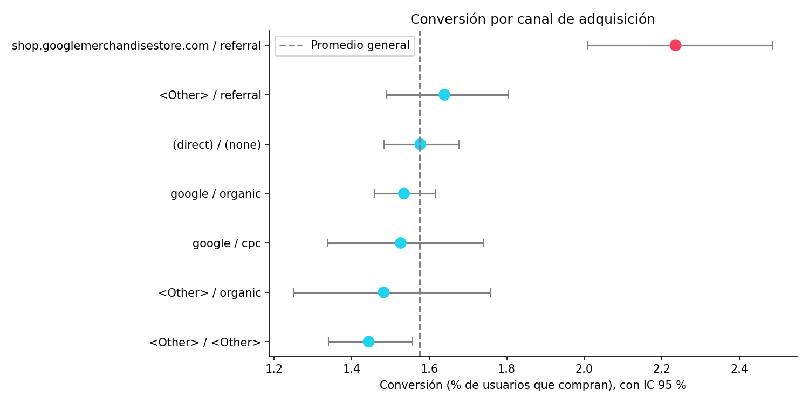
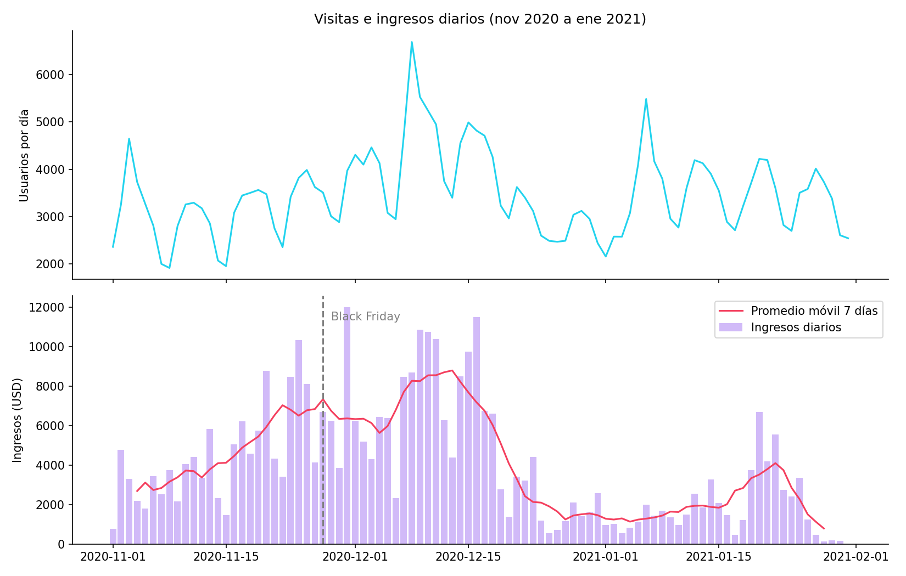
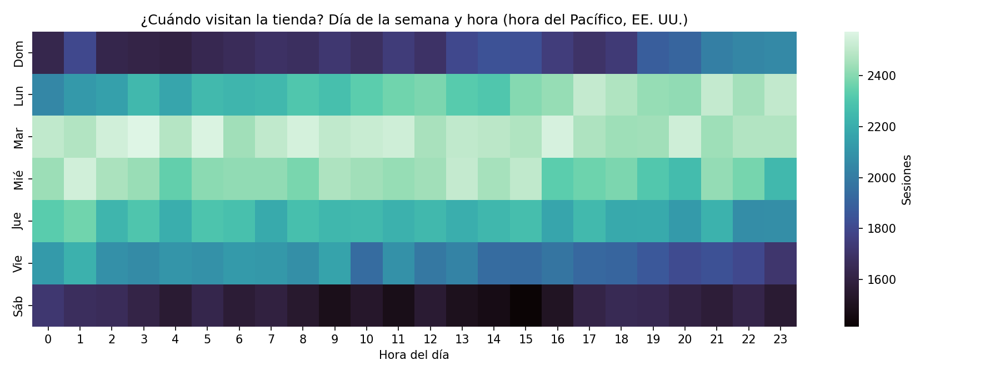

# Marketing Analytics: ¿de dónde vienen los clientes y dónde se pierden?

Proyecto de analítica de marketing en varias fases. La **Fase 1** analiza la adquisición y el embudo de compra de una tienda en línea con datos reales de **Google Analytics 4**, consultados con **SQL en BigQuery** y analizados con **Python** y estadística.

> Estado: **Fase 1 de 6 terminada.** Las demás fases se irán publicando en este mismo repositorio (ver hoja de ruta al final).

## Pregunta de negocio

¿Cuántos visitantes terminan comprando, en qué paso del embudo se pierden más, qué canales de adquisición convierten mejor (y si esa diferencia es real o es ruido) y cuándo visitan la tienda?

## Datos

Muestra pública de GA4 de **Google Merchandise Store** (`bigquery-public-data.ga4_obfuscated_sample_ecommerce`), del **1 de noviembre de 2020 al 31 de enero de 2021**, con identificadores ofuscados. Los datos **no se incluyen en este repositorio**: se consultan directamente en BigQuery (el modo gratuito, *sandbox*, alcanza).

## Cómo se hizo

1. **SQL en BigQuery:** consultas sobre las tablas de eventos (`events_*`).
2. **Atribución por usuario:** cada usuario se asigna al canal de su **primer evento** (`ARRAY_AGG(... ORDER BY event_timestamp LIMIT 1)`). Una primera versión contaba a los usuarios en varios canales (≈333 mil en lugar de 270.154); se corrigió y los totales cuadran.
3. **Embudo:** usuarios únicos que llegan a cada paso.
4. **Estadística:** prueba de independencia chi-cuadrado entre canal y compra, pruebas de un canal contra el resto con **corrección de Holm** para comparaciones múltiples, e **intervalos de confianza de Wilson al 95 %**.
5. **Series de tiempo y patrones:** visitas e ingresos diarios con promedio móvil de 7 días y mapa de calor por día y hora.

## Resultados

### 1. Embudo de compra


De **267.116** usuarios que inician sesión, **4.419 compran (1,65 %)**.

| Paso | Usuarios | % del inicio | % del paso anterior |
|---|---:|---:|---:|
| Inicia sesión | 267.116 | 100 % | |
| Ve un producto | 61.252 | 22,9 % | 22,9 % |
| Agrega al carrito | 12.545 | 4,7 % | 20,5 % |
| Inicia el pago | 9.715 | 3,6 % | 77,4 % |
| Pone envío | 9.714 | 3,6 % | ~100 % |
| Pone pago | 5.751 | 2,2 % | 59,2 % |
| Compra | 4.419 | 1,7 % | 76,8 % |

- **La mayor pérdida está al principio:** solo 2 de cada 10 usuarios ven un producto, y solo 2 de cada 10 de quienes lo ven lo agregan al carrito.
- **Dentro del pago, el paso más débil es "poner pago":** pierde cerca de 4 de cada 10 usuarios que ya habían puesto el envío.
- "Inicia el pago" y "pone envío" tienen casi el mismo número (9.715 y 9.714). Probablemente ambos eventos se disparan juntos en esta tienda, así que no se interpretan como dos pasos distintos.

### 2. Conversión por canal de adquisición



- La conversión general es de **≈1,6 %** de los usuarios.
- El canal `shop.googlemerchandisestore.com / referral` destaca con **≈2,2 %** (IC 95 % aproximado de 2,0 % a 2,5 %), por encima del promedio.
- La prueba chi-cuadrado indica que **la conversión no es igual en todos los canales** (χ² = 49,1; 6 grados de libertad; p < 0,001).
- Para los demás canales, los intervalos de confianza se cruzan con el promedio: con estos datos **no se puede afirmar** que unos sean mejores que otros. Por ejemplo, `google / cpc` (≈1,5 %) tiene un intervalo muy ancho.

### 3. Visitas e ingresos diarios



- Las visitas diarias oscilan entre ≈2.000 y ≈6.700 usuarios, con un pico a inicios de diciembre.
- Los ingresos suben desde mediados de noviembre y alcanzan su nivel más alto en **diciembre** (promedio móvil de 7 días cerca de 8.800 USD, con días de hasta ≈12.000 USD), y caen con fuerza después de Navidad.
- **Black Friday no destaca** en los ingresos de esta muestra frente a otros días de la temporada.

### 4. ¿Cuándo visitan la tienda?



- **Martes y miércoles** concentran más sesiones y el **sábado** es el día más flojo.
- Dentro de cada día, la hora cambia poco. Casi toda la diferencia está entre días de la semana.

## Limitaciones (lo que estos datos no permiten afirmar)

- **No hay datos de gasto en publicidad:** se puede medir conversión por canal, pero no ROAS ni costo por adquisición.
- **Solo 13 semanas, con festivos dentro:** los patrones por día de la semana pueden mezclarse con feriados y temporada.
- **Canales poco informativos:** varios aparecen como `<Other>` por la ofuscación de la muestra, y la categoría `(data deleted)` se excluyó por no ser un canal real.
- **Embudo por usuarios únicos:** cuenta cuántos usuarios llegaron a cada paso, no valida el orden estricto dentro de una misma sesión.
- **Mapa de calor:** asume la hora del Pacífico de EE. UU. (America/Los_Angeles), y la muestra es de una sola tienda.
- Las diferencias entre canales son **asociaciones**, no causalidad.
- Los últimos días de enero muestran ingresos casi nulos; puede ser un artefacto del corte de la muestra y no un comportamiento real.

## Estructura

```
proyecto-marketing-analytics/
├── README.md
├── notebooks/
└── docs/img/
    ├── embudo.png
    ├── conversion_canales.png
    ├── serie_diaria.png
    └── mapa_calor.png
```

## Cómo reproducirlo

1. Crear un proyecto propio en Google Cloud (el *sandbox* de BigQuery es gratis).
2. Abrir el cuaderno de `notebooks/` en Google Colab, cambiar el nombre del proyecto por el tuyo y ejecutar las celdas en orden.

## Hoja de ruta

- [x] **Fase 1:** adquisición y embudo (GA4 en BigQuery)
- [ ] **Fase 2:** segmentación RFM y cohortes de retención (Online Retail II, Excel y Power Query)
- [ ] **Fase 3:** campañas y pruebas estadísticas (Customer Personality Analysis)
- [ ] **Fase 4:** dashboard en Power BI
- [ ] **Fase 5:** automatización semanal con n8n
- [ ] **Fase 6:** informe y resumen en audio con NotebookLM

## Herramientas

Google BigQuery (SQL) · Python (pandas, seaborn, matplotlib, SciPy, statsmodels) · Google Colab · Google Analytics 4
